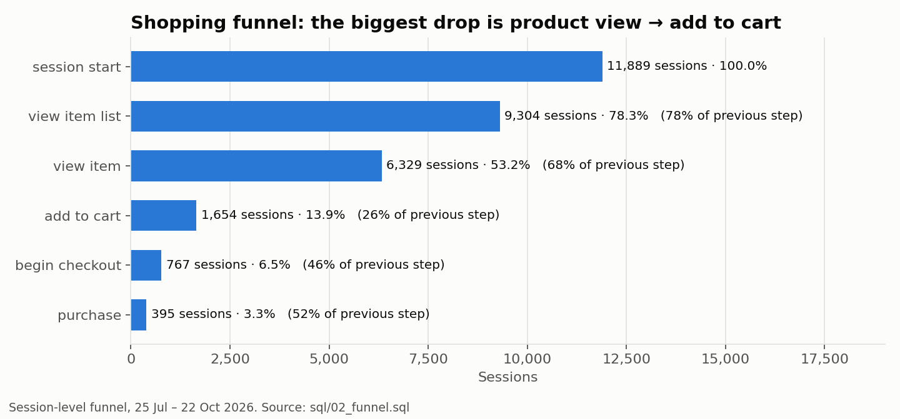

# Piston Hub Analytics — GTM · GA4 · Python · SQL

End-to-end e-commerce analytics for **Piston Hub**, a live bike-accessories store: tracking plan → GTM + GA4 implementation → Python data pipeline → SQL analysis → business recommendations.

**📄 Read the case study: [REPORT.md](REPORT.md)**

| | |
|---|---|
| 🛒 Live store | https://yuvrajbhagyedh.github.io/Piston-hub-Bike-accessory-website/ |
| 🏷️ GTM container | `GTM-WHBDV6TQ` — installed on 27 pages, verified, published |
| 📊 GA4 property | `G-WB9X5NXCLG` — Google tag + 12 e-commerce/engagement events live (GTM version 3) |
| 💡 Key finding | Mobile checkout completes at 41% vs 75% on desktop — fixing it is worth **~+25% revenue** |



## What's inside

```
├── REPORT.md                  ← the case study: findings, insights, recommendations
├── docs/
│   ├── tracking-plan.md       ← business questions → events → parameters
│   ├── gtm-ga4-implementation.md  ← setup steps, screenshots, design decisions, audit findings
│   ├── simulation-assumptions.md  ← how the 90-day dataset was generated and why
│   └── screenshots/           ← GTM install test, GA4 stream, tag config, Tag Assistant, published version
├── gtm/
│   └── piston-hub-gtm-import.json ← GA4 e-commerce tags, triggers, variables (GTM import)
├── src/
│   ├── generate_events.py     ← simulates GA4 events in the live site's exact schema (seeded)
│   ├── clean_and_load.py      ← data-quality checks, cleaning, load to SQLite
│   ├── run_sql.py             ← runs every query in sql/, saves results
│   ├── make_charts.py         ← report charts
│   └── run_pipeline.py        ← runs all of the above
├── sql/                       ← 12 analysis queries (CTEs, window functions, cohorts)
├── data/piston_hub.db         ← cleaned SQLite database (events, event_items)
└── outputs/
    ├── data_quality_report.md
    ├── tables/                ← query results as CSV
    └── charts/                ← PNG charts used in the report
```

The tracking code itself lives in the store's repo: [`analytics.js`](https://github.com/Yuvrajbhagyedh/Piston-hub-Bike-accessory-website/blob/master/analytics.js) (dataLayer events) and [`script.js`](https://github.com/Yuvrajbhagyedh/Piston-hub-Bike-accessory-website/blob/master/script.js) (product catalog).

## Run it

```bash
python3 -m venv .venv
.venv/bin/pip install -r requirements.txt
.venv/bin/python src/run_pipeline.py
```

Takes a few seconds. Output is deterministic (seed 42), so every number in the report regenerates exactly.

Explore the data yourself:

```bash
sqlite3 data/piston_hub.db < sql/02_funnel.sql
```

## SQL queries

| # | Question |
|---|---|
| 01 | Headline KPIs |
| 02 | Where do we lose shoppers? (funnel with step conversion via window functions) |
| 03 | Mobile vs desktop funnel |
| 04 | Which channels bring buyers, not just visitors? |
| 05 | Which products get attention vs. actually sell? |
| 06 | Category comparison |
| 07 | Daily trend with 7-day rolling averages and festive flag |
| 08 | Abandoned cart value by device |
| 09 | City performance with revenue rank |
| 10 | New vs returning visitors |
| 11 | Weekly cohort retention |
| 12 | Which shop entry pages lead to carts? |

## A note on the data

The store is real and the GTM/GA4 tracking is live, but the store has no customer traffic yet. The analysis therefore runs on 90 days of **simulated** events that follow the exact event names, parameters and catalog the live site sends — with realistic data-quality problems injected (duplicate purchases, `(not set)` categories, internal test traffic) for the cleaning step to catch. See [docs/simulation-assumptions.md](docs/simulation-assumptions.md). Swapping in a real GA4 BigQuery export only changes the loader.

---
Yuvraj K · [GitHub](https://github.com/Yuvrajbhagyedh)
