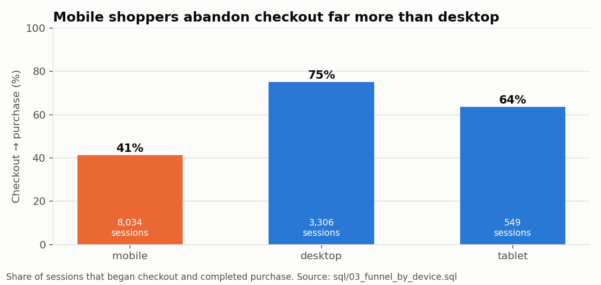
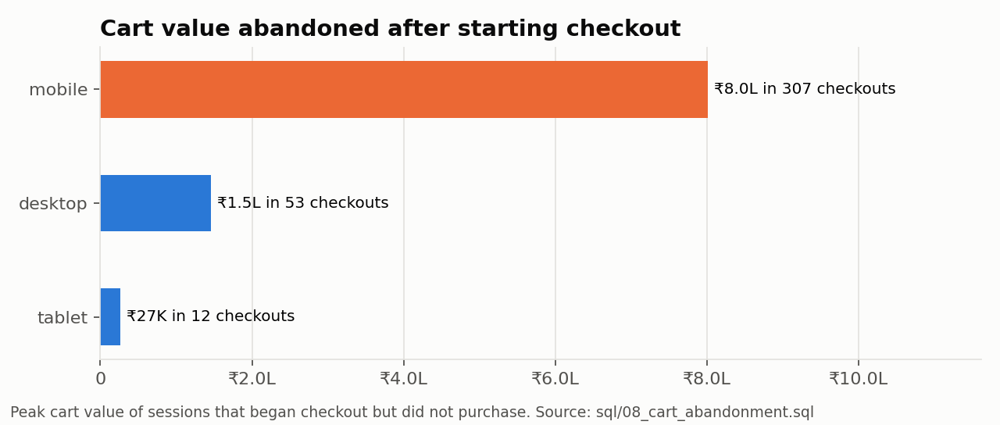
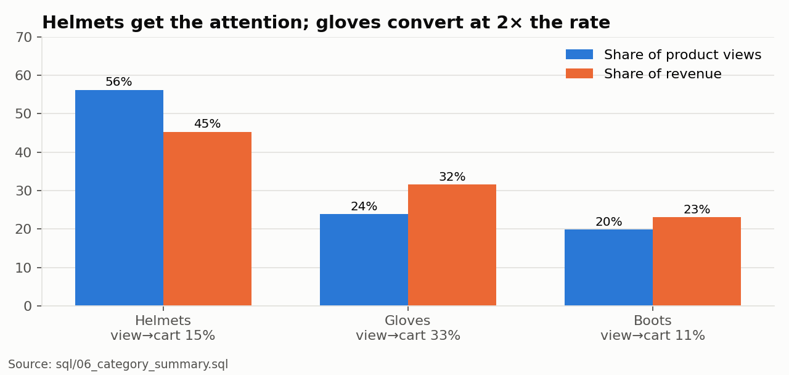
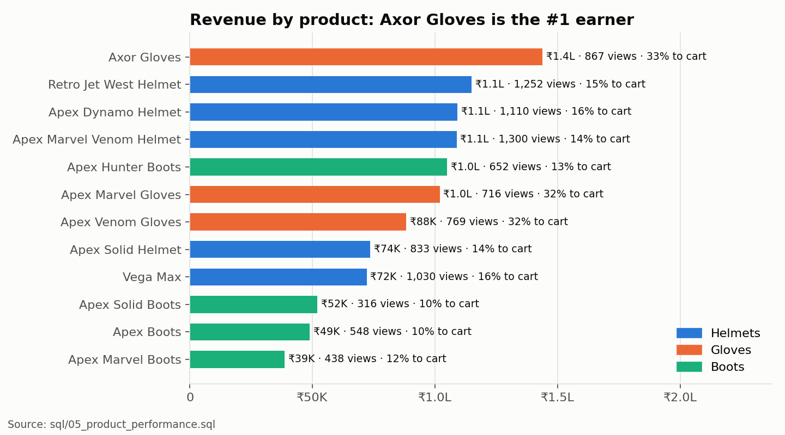
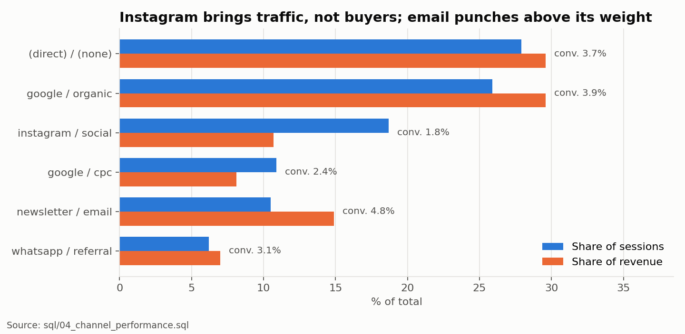
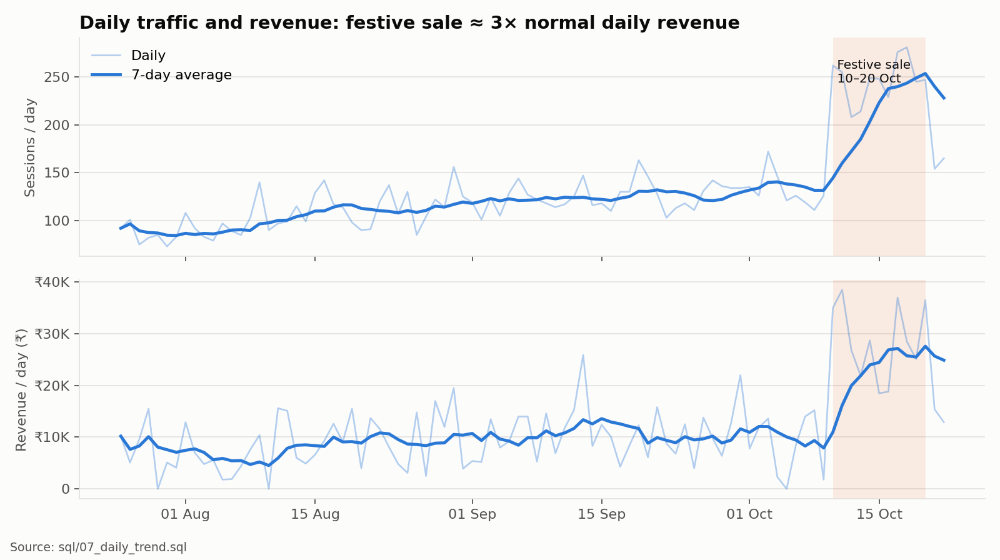
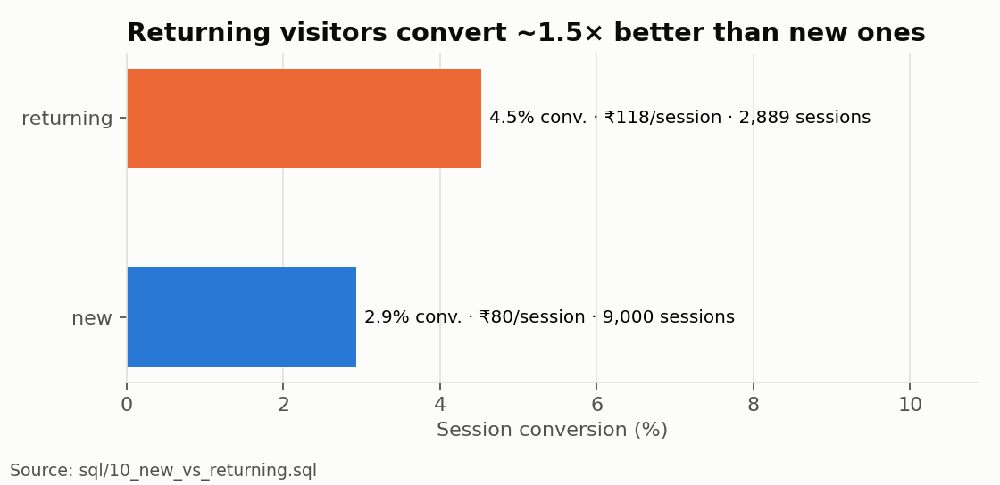
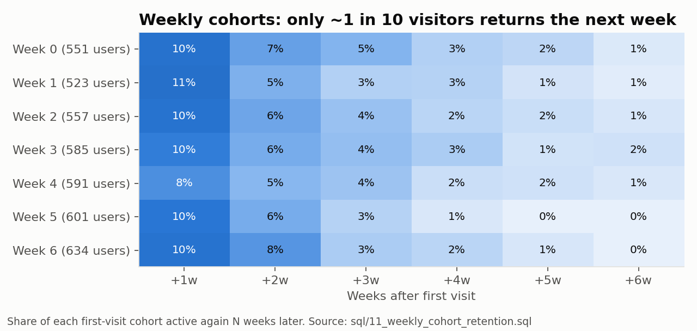

# Piston Hub – Analytics Case Study

Yuvraj K, October 2026

## Background

Piston Hub is an online store I built that sells bike riding gear: helmets, gloves and boots. For this case study I wanted to answer a few simple questions a store owner would ask:

- Where do people drop off before buying?
- Which products and marketing channels actually bring in money?
- What should be fixed first?

To do that I set up tracking on the live site with Google Tag Manager and GA4, then built a small Python + SQL pipeline to analyse the data.

Links:
- Live store: https://yuvrajbhagyedh.github.io/Piston-hub-Bike-accessory-website/
- GTM container: GTM-WHBDV6TQ, GA4 property: G-WB9X5NXCLG

## 1. Tracking setup (GTM + GA4)

First I wrote a [tracking plan](docs/tracking-plan.md) listing the events I needed and why. I used GA4's standard e-commerce event names (`view_item`, `add_to_cart`, `begin_checkout`, `purchase` etc.) so GA4's built-in reports work without extra setup.

Then:

1. Added the GTM snippet to all 27 customer pages. I left out the admin pages so my own activity doesn't get counted.
2. Created the GA4 property and web stream and added the Google tag in GTM.
3. Wrote `analytics.js` on the site to push 12 events to the dataLayer with product details (id, name, brand, category, price, quantity).
4. Created two GA4 event tags in GTM, one for e-commerce events and one for others like sign up and contact form, using regex triggers so I didn't need a separate tag per event.
5. Tested in Tag Assistant, published, and checked on the live site that GA4 was receiving `view_item` and `add_to_cart` with the product data.

I made sure no personal data (name, email, phone, address) is sent to GA4. Only the city is sent with orders.

Setup steps and screenshots are in [docs/gtm-ga4-implementation.md](docs/gtm-ga4-implementation.md).

### Bugs I found while setting up tracking

Setting up tracking made me look at the site closely and I found several problems:

- List pages showed prices in dollars ($19.99) while product pages showed rupees (₹500).
- One product was called "Product 5", and two helmets were listed under "Tools".
- The Apex Marvel Boots page had the title of a different product.
- Add to Cart and Buy Now didn't work on 11 of the 12 product pages.
- Login and checkout didn't work on the live site because the backend isn't hosted on GitHub Pages. I added a demo mode so the full flow works.

I fixed these by keeping all product details in one place in the code.

## 2. The data

The store doesn't have real customers yet, so I wrote a Python script ([generate_events.py](src/generate_events.py)) that creates 90 days of shopper data (about 9,000 users and 65,000 events) in the same format the site sends to GA4. The assumptions behind it are written down in [docs/simulation-assumptions.md](docs/simulation-assumptions.md).

I also added some common data problems on purpose so the cleaning step had something to catch.

## 3. Cleaning the data

[clean_and_load.py](src/clean_and_load.py) checks the data before loading it into SQLite. It found:

- **280 test events from localhost.** These were removed. Left in, my test orders of ₹9,999 would have skewed the averages.
- **11 purchases recorded twice** on 14–16 Sep. This doubled the revenue for those days (₹30.8K showed as ₹61.6K). I kept only one per order ID.
- **About 3% of products missing a category.** I filled these in from the product list.

Full results: [outputs/data_quality_report.md](outputs/data_quality_report.md)

## 4. Results

All numbers come from the SQL queries in the [sql/](sql/) folder.

**Overall (25 Jul – 22 Oct):** 9,000 users, 11,889 sessions, 395 orders, ₹10.58 lakh revenue, ₹2,677 average order, 3.3% conversion.

### Where people drop off


The biggest drop is between viewing a product and adding it to cart. Only about 1 in 4 people who view a product add it.

### Mobile checkout is the main problem



Most visitors (68%) are on mobile. Mobile and desktop users add to cart at about the same rate, but once they reach checkout only 41% of mobile users finish, compared with 75% on desktop. So the issue is the checkout form on mobile, not lack of interest.



About ₹8 lakh worth of carts were left at checkout on mobile. If mobile completion went up to even 60%, that's roughly 98 more orders, around ₹2.6 lakh more per quarter (about 25% more revenue).

### Products





- Helmets get the most views (56%) but people take longer to decide on them.
- Gloves get added to cart about twice as often as helmets, and Axor Gloves is the top-selling product.
- Boots are the hardest to sell. Apex Marvel Boots has the lowest conversion.
- Most orders have just one item (1.18 on average), so people rarely buy a helmet and gloves together.

### Marketing channels



Instagram brings a lot of visitors (19% of sessions) but few buyers (1.8% conversion). Email brings fewer visitors but they convert best (4.8%). Each email visit is worth about ₹127, compared with ₹51 for an Instagram visit.

### Festive sale



During the Navratri–Dussehra sale (10–20 Oct), daily visits almost doubled and daily revenue went up about 3 times compared with the two weeks before.

### Returning visitors





Returning visitors convert better (4.5% vs 2.9%), but only about 1 in 10 people come back the next week, and very few buy a second time.

### Things that didn't matter much

Which page people started shopping from (all products vs. a bike brand page) and which city they were in didn't make a big difference to conversion. One useful point: about 61% of revenue comes from outside Bengaluru.

## 5. What I would do

1. **Fix mobile checkout first.** Make the form shorter, auto-fill the city from the PIN code, add UPI and a guest checkout. This has the biggest impact (around +25% revenue). To find the exact problem field, I'd add a GTM event for form errors at each checkout step.
2. **Suggest gloves on helmet pages and in the cart**, maybe as a helmet + gloves bundle. Gloves sell easily, and this could add around ₹1 lakh per quarter.
3. **Use Instagram differently.** Use it for retargeting ads that lead to products like gloves, with proper UTM tags, and check in GA4 whether it helps other channels before cutting the budget.
4. **Bring people back** with abandoned-cart reminders on email/WhatsApp and a festive early-access list. Returning visitors are worth about 1.5 times as much.
5. **Make boots easier to buy:** add a size guide, reviews and easy size exchange.
6. **Plan for festivals early**, since that's when most sales happen. Diwali is next.
7. **Keep the data clean:** set up the internal traffic filter in GA4, stop duplicate purchases in the tag, and add a cookie consent banner.

## 6. Next steps

- Mark purchase, sign up and contact form as key events in GA4.
- Connect GA4 to BigQuery and point the pipeline at real data once the store has traffic.
- Build a simple Looker Studio dashboard from the main queries.

## Running the code

```bash
python3 -m venv .venv
.venv/bin/pip install -r requirements.txt
.venv/bin/python src/run_pipeline.py
```

The data is generated with a fixed seed, so the numbers above will come out the same every time.
