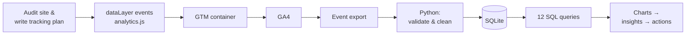

# Piston Hub — E-commerce Analytics Case Study

**GTM · GA4 · Python · SQL** — Yuvraj K · October 2026

> **In one line:** I instrumented a live bike-accessories store with Google Tag Manager and GA4 e-commerce tracking, built a Python + SQL pipeline on GA4-format event data, and found that a broken mobile checkout is the single biggest revenue leak — fixing it is worth roughly **+25% revenue**.

| | |
|---|---|
| Live store | https://yuvrajbhagyedh.github.io/Piston-hub-Bike-accessory-website/ |
| Tracking | GTM `GTM-WHBDV6TQ` → GA4 `G-WB9X5NXCLG` (live; e-commerce hits verified on the production site) |
| Analysis data | 90 days, 9,000 users, 65k events — simulated in the exact GA4 schema the live site sends ([why & how](docs/simulation-assumptions.md)) |

---

## 1. The business problem

Piston Hub is a Bengaluru D2C store selling riding gear — helmets, gloves and boots — online. Before this project the owner could not answer basic questions:

1. Where in the journey do shoppers drop out?
2. Which products and marketing channels actually make money?
3. What should we fix first?

The site had no analytics at all, and — as the tracking audit later showed — several silent bugs that no one had noticed because nothing was being measured.

## 2. Approach



| Phase | What I did | Where |
|---|---|---|
| **Plan** | Mapped business questions to GA4 recommended e-commerce events and an item schema | [Tracking plan](docs/tracking-plan.md) |
| **GTM + GA4** | Installed GTM on 27 pages (admin excluded), created GA4 property and stream, Google tag on Initialization, verified in Tag Assistant, published v2 | [Implementation](docs/gtm-ga4-implementation.md) |
| **dataLayer** | `analytics.js` pushes 12 events with full item data; GTM import file with 2 GA4 event tags, 2 regex triggers, 7 variables | [site repo](https://github.com/Yuvrajbhagyedh/Piston-hub-Bike-accessory-website/blob/master/analytics.js), [`gtm/`](gtm/piston-hub-gtm-import.json) |
| **Python** | Event generator (GA4 schema), validation & cleaning with a data-quality report, SQL runner, chart builder | [`src/`](src/) |
| **SQL** | 12 queries: funnel, device, channel, product, category, trend (window functions), abandonment, city, new vs returning, cohort retention, entry pages | [`sql/`](sql/) |

## 3. GTM & GA4 implementation highlights

- **Live and verified.** GTM container found on the live URL; Tag Assistant shows *GA4 - Google Tag* fired to `G-WB9X5NXCLG`; e-commerce tags published as version 3, and live GA4 hits for `view_item` / `add_to_cart` confirmed with full item data. [Screenshots](docs/gtm-ga4-implementation.md).
- **Robust event design.** Instead of tagging each button, `analytics.js` wraps the store's own `addToCart`, `removeFromCart`, `createOrder`, `loginUser` and `signupUser` functions — any UI path that changes the cart is tracked, and redesigns don't break tracking.
- **Lean GTM container.** Two GA4 event tags driven by regex Custom Event triggers instead of 12 near-identical tags; adding an event is a one-word change.
- **Privacy by design.** No name, email, phone, address or free text ever reaches GA4; only city. Admin pages don't load GTM.
- **The audit found and fixed real bugs:** mixed currencies (`$19.99` on lists vs `₹500` on product pages), a product named "Product 5", helmets categorised as "Tools", a boots page titled as gloves, and *Add to Cart* doing nothing on 11 of 12 product pages. Each one would have silently corrupted reports.

## 4. Data quality — cleaned before analysis

| Issue found | Impact if ignored | Fix |
|---|---|---|
| 280 events from `localhost` (QA test orders at ₹9,999) | Inflated AOV and wrong top products | Removed; recommend GA4 internal-traffic filter |
| 11 duplicate `purchase` events (same `transaction_id`, 14–16 Sep) | Revenue for those days **doubled** (₹30.8K shown as ₹61.6K) | De-duplicated on `transaction_id`; recommend dedupe in the purchase tag |
| 3% of items with `item_category = "(not set)"` | Category revenue understated | Repaired from catalog via `item_id` |
| Purchase value vs Σ item price × qty | — | Reconciled: 0 mismatches |

Full report: [`outputs/data_quality_report.md`](outputs/data_quality_report.md)

## 5. Headline KPIs (25 Jul – 22 Oct 2026)

| Users | Sessions | Orders | Revenue | Avg order value | Conversion | Revenue / session |
|---|---|---|---|---|---|---|
| 9,000 | 11,889 | 395 | **₹10.58 lakh** | ₹2,677 | 3.32% | ₹89 |

## 6. Findings

### 6.1 The funnel leaks most between product view and cart


Only **26%** of sessions that view a product add anything to the cart — the largest absolute loss (4,675 sessions). Of carts, 46% start checkout; of checkouts, 52% complete.

### 6.2 Mobile checkout is broken — the biggest single fix


68% of sessions are on mobile, yet mobile shoppers who **start** checkout complete it only **41%** of the time vs **75%** on desktop. Shoppers on both devices add to cart at similar rates (26% vs 28%), so the problem is not interest — it is the checkout form itself.


**₹8.0 lakh** of cart value was abandoned *after* mobile users had started checkout.
**Sizing:** 522 mobile checkouts → 215 orders. At even 60% completion (still below desktop): **+98 orders × ₹2,677 ≈ ₹2.6 lakh per quarter, ~+25% revenue.**

### 6.3 Helmets get attention; gloves close the sale


- Helmets take **56%** of product views but **45%** of revenue — browsed a lot, bought cautiously (15% view→cart).
- Gloves convert at **33%** view→cart — 2.2× helmets — and sell the most units (216). **Axor Gloves is the #1 product by revenue.**
- Boots are the hardest sell: 11% view→cart at ₹3.5–5K. *Apex Marvel Boots* converts only 2.1% of viewers — the weakest product.
- Orders contain just **1.18 items** on average — almost nobody buys a helmet *and* gloves together.

### 6.4 Instagram brings visitors, not buyers; email is the most efficient channel


| Channel | Share of sessions | Share of revenue | Conversion | ₹ / session |
|---|---|---|---|---|
| Instagram | 18.7% | 10.7% | **1.8%** | ₹51 |
| Google Ads (cpc) | 10.9% | 8.1% | 2.4% | ₹67 |
| Google organic | 25.9% | 29.6% | 3.9% | ₹102 |
| Email newsletter | 10.5% | 14.9% | **4.8%** | **₹127** |

Instagram sessions are worth **40% of an email session**. Paid search also under-performs organic.

### 6.5 Festive sale: ~2× traffic, ~3× revenue


During Navratri–Dussehra (10–20 Oct) daily sessions rose **1.9×** vs the previous two weeks, conversion rose from 2.5% to **4.3%**, and daily revenue rose **2.9×** (₹10.0K → ₹28.7K). Festive demand is the business's biggest lever, and it is predictable.

### 6.6 Returning visitors are worth 1.5× — but few come back


Returning sessions convert at 4.5% vs 2.9% for new ones (₹118 vs ₹80 per session), yet only **~10%** of visitors return the following week and **~1–2%** by week six. Only 8 of 387 buyers (2%) bought again.

### 6.7 What does *not* matter (so we don't waste effort)

- **Entry page:** sessions starting from the all-products page vs bike pages (Royal Enfield, Pulsar…) or brand pages convert within about a point of each other (3.4–4.6%) on a few hundred sessions each — no meaningful difference. [`sql/12`](sql/12_list_page_performance.sql)
- **City:** Bengaluru drives 43% of sessions and 39% of revenue; other cities convert at similar rates (3.0–4.0%). 61% of revenue already comes from outside Bengaluru, so shipping coverage beyond Karnataka is worth protecting. [`sql/09`](sql/09_city_performance.sql)

## 7. Recommendations — prioritised

| # | Action | Why (evidence) | Expected impact | How to measure (GTM/GA4) |
|---|---|---|---|---|
| 1 | **Fix mobile checkout:** autofill, PIN-code → city lookup, UPI one-tap, sticky *Pay* button, guest checkout | 41% vs 75% completion; ₹8.0L abandoned at checkout | **+₹2.6L / quarter (~+25%)** at 60% completion | Add `checkout_step` and `form_error` (field name) events in GTM to find the exact failing field; compare checkout→purchase by device weekly |
| 2 | **"Complete your kit" cross-sell:** suggest gloves on helmet pages and in cart; helmet + gloves bundle | Gloves convert 2.2× helmets; 1.18 items/order | Items/order 1.18 → 1.35 ≈ +₹1L / quarter (0.17 × ~₹1,500 gloves × 395 orders) | Track `view_promotion` / `select_promotion`; watch items per order and AOV |
| 3 | **Re-target Instagram, don't cut it:** shift from reach to catalog / retargeting ads landing on gloves; strict UTMs | 18.7% of traffic, 1.8% conversion, ₹51/session | Instagram ₹/session toward the ₹90 site average | UTM-tagged campaigns; GA4 attribution paths to check Instagram's *assisted* conversions before cutting budget |
| 4 | **Retention engine:** abandoned-cart email/WhatsApp, post-purchase "care kit" email, festive early-access list | Returning visitors worth 1.5×; ~10% return; 2% repeat buyers | 1,259 abandoned carts / quarter to recover | `sign_up` as key event; email/WhatsApp UTMs; cohort query (`sql/11`) each month |
| 5 | **Make boots easier to buy:** size guide, fit reviews, no-cost EMI, free size exchange; test price on Apex Marvel Boots | 11% view→cart, 2.1% view→purchase on Apex Marvel Boots | Boots view→cart 11% → 15% | `view_item` → `add_to_cart` by product (`sql/05`) before/after |
| 6 | **Plan festive peaks early:** stock, campaigns and email capture start 1 week before Navratri; Diwali next | 1.9× traffic, 2.9× revenue in the sale | Bigger peak, and festive visitors captured for retention | Daily trend query (`sql/07`) with 7-day average as a live dashboard |
| 7 | **Protect data quality:** GA4 internal-traffic filter, dedupe purchases by `transaction_id`, Consent Mode v2, daily anomaly check | Duplicates doubled revenue for 3 days; QA orders in production | Trustworthy numbers | Data-quality script as a scheduled job; alert if orders/day > 3× 7-day average |

## 8. Next steps

1. Mark `purchase`, `generate_lead`, `sign_up` as key events in GA4 and register the custom dimensions (the e-commerce tags are already live in GTM version 3).
2. Link GA4 → BigQuery (free daily export) and point `clean_and_load.py` at the export instead of the simulator; the SQL is written against the same flattened schema.
3. Build a Looker Studio dashboard on the funnel, device and channel queries for the weekly review.
4. Run the mobile checkout fix as an A/B test and measure with the funnel-by-device query.

## 9. Reproduce everything

```bash
python3 -m venv .venv && .venv/bin/pip install -r requirements.txt
.venv/bin/python src/run_pipeline.py
```

Deterministic (seed 42): every number in this report regenerates exactly. Query the database directly with `sqlite3 data/piston_hub.db`.
