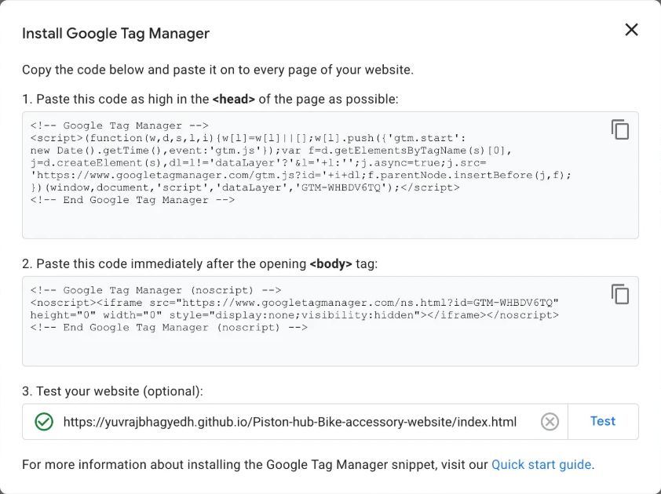
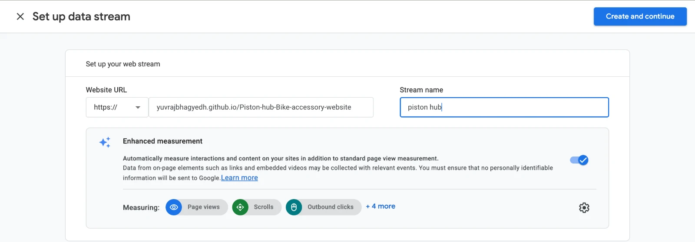
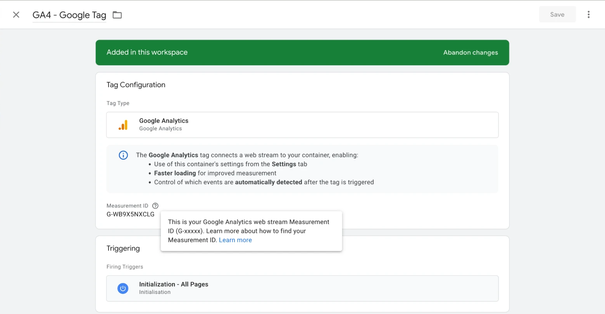
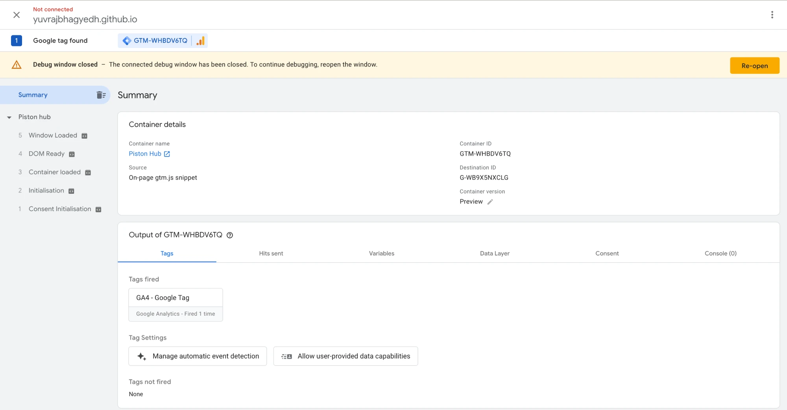
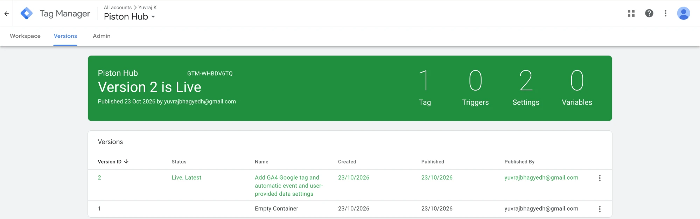

# GTM + GA4 Implementation

| Item | Value |
|---|---|
| Website | https://yuvrajbhagyedh.github.io/Piston-hub-Bike-accessory-website/ |
| Site source code | https://github.com/Yuvrajbhagyedh/Piston-hub-Bike-accessory-website |
| GTM container | `GTM-WHBDV6TQ` (Web) |
| GA4 property / stream | Piston Hub · Measurement ID `G-WB9X5NXCLG` · Enhanced Measurement ON |

## Architecture

```mermaid
flowchart LR
  A[Shopper's browser<br/>Piston Hub pages] -->|dataLayer.push| B[analytics.js<br/>e-commerce events]
  B --> C[GTM container<br/>GTM-WHBDV6TQ]
  C -->|Google tag + GA4 event tags| D[GA4 property<br/>G-WB9X5NXCLG]
  D -->|BigQuery export / API| E[Raw events]
  E --> F[Python: validate & clean]
  F --> G[(SQLite / BigQuery)]
  G --> H[SQL analysis]
  H --> I[Charts, insights,<br/>recommendations]
```

Why GTM sits in the middle: the site code only describes *what happened* (`dataLayer.push`). *Where it goes* (GA4 today, Meta Pixel or Google Ads tomorrow) is configured in GTM by the marketing team with no code release.

## Step 1 — Install the GTM container on the site

The GTM snippet was added to **27 customer-facing pages** — the `<script>` as high as possible in `<head>`, the `<noscript>` iframe right after `<body>`.
The 2 admin pages were deliberately excluded so internal activity never reaches analytics.

GTM's installation test confirmed the container on the live URL:

## Step 2 — Create the GA4 property and web stream

Property "Piston Hub" (India time zone, INR), business objectives *Drive sales* + *View user engagement and retention*,
web stream for the site URL with Enhanced Measurement (page views, scrolls, outbound clicks, site search, form interactions, video, file downloads).

## Step 3 — GA4 Google tag in GTM

Tag type **Google Analytics** (the Google tag) with Measurement ID `G-WB9X5NXCLG`, firing on **Initialization – All Pages** so it loads before any other tag.

## Step 4 — Verify in Preview (Tag Assistant)

Tag Assistant connected to the live site: container found, destination `G-WB9X5NXCLG`, tag **GA4 - Google Tag fired**, no tags failed.

## Step 5 — Publish

Version 2 published and live.

## Step 6 — E-commerce events (dataLayer + GA4 event tags)

**Website side (done, live):** `analytics.js` pushes all events in the [tracking plan](tracking-plan.md). It wraps the store's cart/order/auth functions, so every add, remove and purchase is tracked whichever page triggered it — no per-button tagging that breaks when the UI changes.
Verified in the browser on all 27 pages: each page fires the expected event, and a full journey produced
`view_item_list → add_to_cart → view_cart → remove_from_cart → begin_checkout → purchase` with correct items and INR values.

**GTM side (import file ready):** [`gtm/piston-hub-gtm-import.json`](../gtm/piston-hub-gtm-import.json) adds:

| Type | Name | Purpose |
|---|---|---|
| Tag | GA4 Event - Ecommerce | Sends `{{Event}}` to GA4 with *Send e-commerce data* from the dataLayer, plus `shipping_city`, `order_type` |
| Tag | GA4 Event - Engagement | Sends `login`, `sign_up`, `generate_lead`, `select_content` with their parameters |
| Trigger | CE - Ecommerce events | Custom Event, regex `^(view_item_list\|select_item\|view_item\|add_to_cart\|remove_from_cart\|view_cart\|begin_checkout\|purchase)$` |
| Trigger | CE - Engagement events | Custom Event, regex `^(login\|sign_up\|generate_lead\|select_content)$` |
| Variables | GA4 Measurement ID, 6 × Data Layer Variables | Re-usable constants and event parameters |

Two tags with regex triggers instead of 12 one-event tags keeps the container small and easy to audit — adding a new e-commerce event is a one-word change to the regex.

**Import:** GTM → Admin → Import Container → choose the JSON → *Existing workspace* → *Merge, overwrite conflicts* → Preview → Submit.

## Design decisions

| Decision | Reason |
|---|---|
| GA4 recommended event names | GA4 Monetization reports, funnels and BigQuery schemas work out of the box |
| `item_id` = product page slug | Stable key that survives product renames; joins cleanly with the catalog |
| `dataLayer.push({ecommerce: null})` before each e-commerce push | Prevents items from a previous event leaking into the next one (common GTM bug) |
| One product catalog in code | Audit found prices shown as `$19.99` on list pages and `₹500` on product pages, a product named "Product 5", and helmets categorised as "Tools". A single catalog fixed every page and every event at once |
| Demo checkout/login when no backend | GitHub Pages can't run the Node backend; the demo fallback lets the full funnel (including `purchase`) work on the static site, flagged with `order_type: "demo"` so it can be filtered out |
| No PII in events | GA4 terms prohibit PII; only city-level location is sent |

## Tracking audit findings on the original site

The tracking work surfaced real defects on the site, all fixed:

1. Shop and brand pages showed USD prices (`$19.99`) while product pages and cart used INR (`₹500`) — revenue would have been recorded in mixed currencies.
2. A product card was named **"Product 5"** and two helmets were categorised as **"Tools"** on 6 bike/brand pages.
3. The *Apex Marvel Boots* page was titled "Apex Venom Gloves" — its views would have been credited to the wrong product.
4. *Add to Cart* and *Buy Now* did nothing on 11 of 12 product pages — a broken funnel step invisible without tracking.
5. Signup, login and checkout failed on the live site (backend not deployed) — fixed with a demo-mode fallback.
